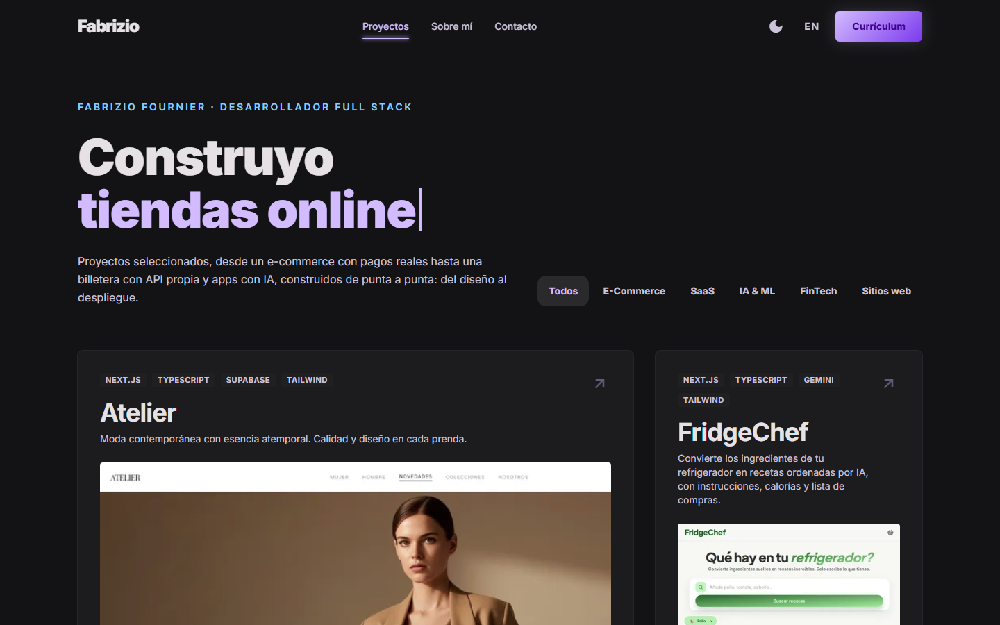
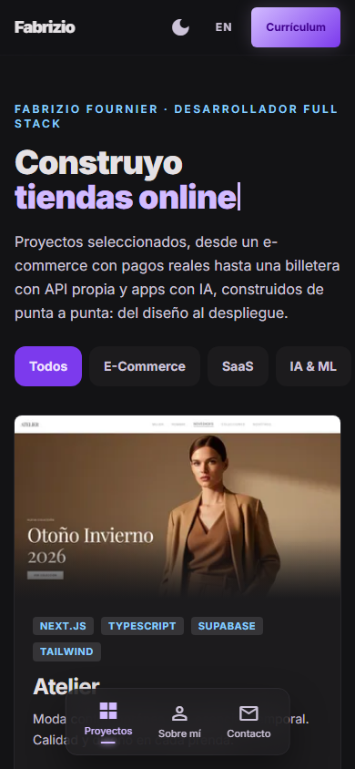
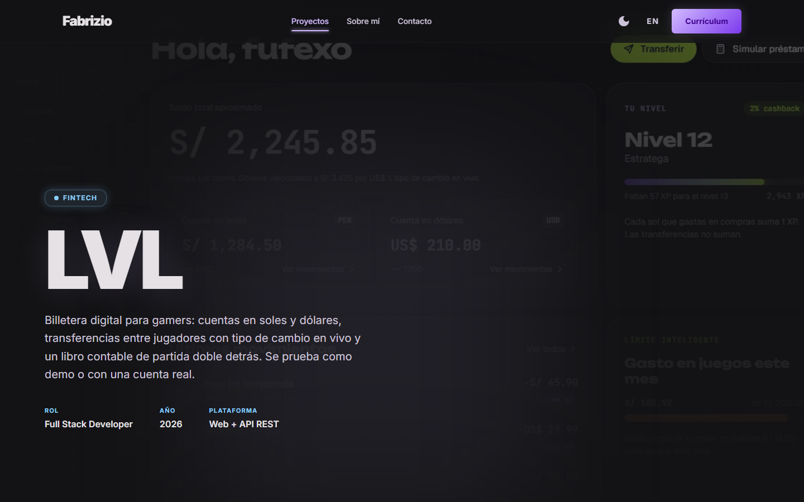

# Fabrizio — Portfolio

Personal portfolio of Fabrizio Fournier, full stack developer specialized in Angular. Bilingual (ES/EN), built with Astro and Tailwind CSS v4.

**Live:** [fabrizio-fournier.vercel.app](https://fabrizio-fournier.vercel.app) · [English version](https://fabrizio-fournier.vercel.app/en/)



## Projects

| Project | What it is | Stack |
| --- | --- | --- |
| [Atelier](https://fabrizio-fournier.vercel.app/proyectos/atelier/) | Fashion e-commerce with real payments (Culqi), admin panel and transactional emails | Next.js · Supabase · Tailwind |
| [FridgeChef](https://fabrizio-fournier.vercel.app/proyectos/fridgechef/) | Recipes generated by AI from the ingredients in your fridge | Next.js · Gemini · Zustand |
| [LVL](https://fabrizio-fournier.vercel.app/proyectos/lvl/) | Digital wallet for gamers with its own API: PEN/USD accounts, live-rate transfers, double-entry ledger | Angular 22 · Spring Boot 4 · PostgreSQL |

Each project has its own case study: the problem, the challenges and how they were solved, the stack and a gallery.

<table>
  <tr>
    <td width="68%"></td>
    <td width="32%"></td>
  </tr>
</table>



## How it's built

- **Astro 7 + Tailwind CSS v4**, fully static, with no UI framework: interactivity is plain TypeScript.
- **Real URLs per language:** Spanish at `/` and English at `/en/`, both prerendered as HTML so search engines index each one.
- **Case studies as data:** every project is a JSON file validated with a Zod schema, and one template renders them all. Adding a project means adding a folder.
- **Optimized images:** WebP with `srcset`, generated at build time.
- **SEO:** Open Graph previews, canonical URLs, `hreflang`, a bilingual sitemap and `robots.txt`.
- **Accessible:** keyboard-navigable tabs, skip link, visible focus and reduced-motion support.

## Run locally

```bash
npm install
npm run dev   # http://localhost:4321
```
